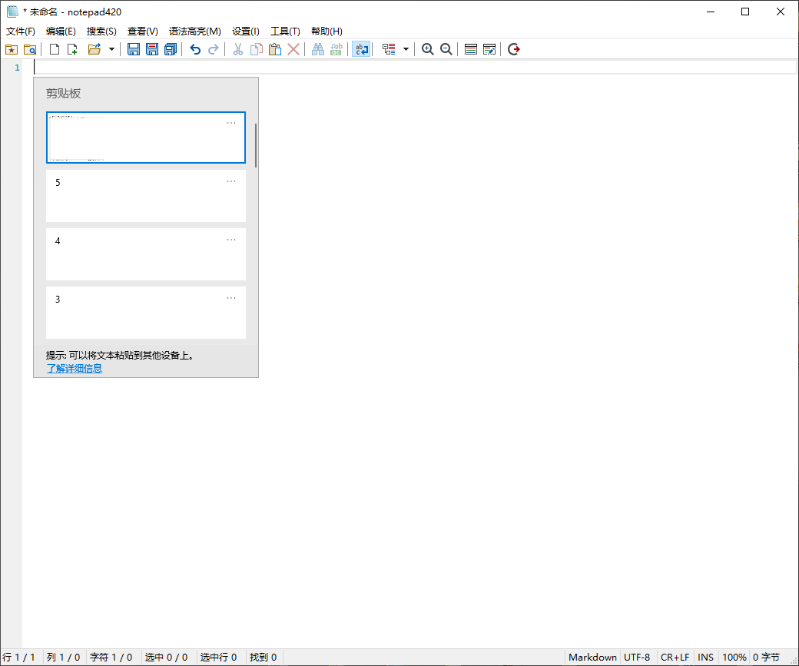

# notepad420

[English](README.md) · 简体中文

> Windows 系统记事本替身 —— [Notepad4](https://github.com/zufuliu/notepad4)（zufuliu）的个人 fork，按需 cherry-pick，不跟上游主线。
>
> **使命：让 Harness（Codex / Claude Code / pi 等）里 Ctrl+G 打开的文本编辑器无痛承载截图给 AI。**截图丢进去，跳出来的是 `C:\...\Temp\notepad420-Paste\xxxx.png` 的文件路径——不再贴 data URI，不再手动找路径。

[](License.txt) [](https://github.com/Sakyvo/notepad420/releases) [](https://github.com/Sakyvo/notepad420/releases)

## 图片粘贴——本 fork 的存在理由

- 复制任意图片，在 np420 中直接 **Ctrl+V**
- np420 自动把图片保存到 `%TEMP%\notepad420-Paste\<时间戳>.png`，并把**文件路径**粘到光标处——文档里从此是路径，不是冗长的 base64
- 反向粘贴 **Ctrl+Shift+V**：把图片 data URI 原样粘贴，不落盘
- 资源管理器复制文件（或拖入）直接得到路径文本
- Markdown 文本里内嵌的 data URI 图片解码进缓存目录并原位替换为路径
- 不设张数/容量上限：缓存按需增长，由专门对话框管理（设置 → **粘贴图片缓存管理**）：手动按天数清理（带确认框），可选每日首次启动自动清理（默认关闭）；缓存位置可配置（`PasteCacheDir`）

| Ctrl+G 唤出（未贴入） | 贴入后得到缓存路径 |
| --- | --- |
|  |  |

不再手动「另存为」，不再离开终端去分享一张截图。

## Markdown 自动排版

编辑器为 Markdown 开箱即用：

- **列表自动补全**（kedit 式，默认开启）：光标在列表项末尾按 Enter，新行自动续上同缩进标记——块引用 `> `、无序 `* + -`、有序 `1. `——含任务列表 checkbox `[ ]` / `[x]`；有序列表同级自动重排；空标记行再按 Enter 删掉标记留空行
- **默认方案即 Markdown**（GitHub GFM）：空白/未知扩展名文档打开即高亮，NP3 风格标题/粗体/斜体外观
- **使用默认代码样式**对所有语法默认启用

## 智能编辑细节

- **Ctrl+左键打开路径**：存在的文件/文件夹路径（绝对、UNC、相对、引号包裹含空格）获得与 URL 相同的热点样式——Ctrl+点击交系统默认程序打开（文件夹→资源管理器，图片→看图器）
- **Ctrl+J 插入换行**，与 Enter 完全一致（自动缩进、列表续行、选区替换），设置 → 额外 Esc 键功能下开关，默认开启
- **启动时选项**：设置 → 启动时，选择打开文件时光标落在开头还是末尾，视图是否随之滚动
- **中键自动滚动**（NP3 语义）：按住中键拖动即滚动；短按切换持续滚动模式
- 默认调参：四重绘制动效、F60FastScroll 高刷新率滚动

## 记事本替换器

`notepad420-replacer.exe`——一键工具（需管理员）：

- 替换系统记事本（物理覆盖，原件备份为 `notepad.exe.bak`）
- 关联 25 项文本文件扩展名
- 接管终端 Ctrl+G 外部编辑器（`EDITOR` / `VISUAL`）

带实时进度条与四行紧凑完成报告；`--restore` 全量回滚，安装器完成页可代跑。

## 下载与安装

从 [Releases](https://github.com/Sakyvo/notepad420/releases) 取最新版：

| 文件 | 用途 |
|---|---|
| `notepad420-setup-x64-<ver>.exe` | 安装器（English/简体中文 双语随系统语言；完成页可选替换系统记事本 / 关联文本文件 / 接管 Ctrl+G） |
| `notepad420_i18n_x64_v<ver>.zip` | 便携包（解压即用，含替换器） |

要求 Windows 10 x64 及以上。交付语言：**English + 简体中文**。

## 从源码构建

详见[构建与输出契约](.docs/spec/build-output.md)（所有生成物只落 `.target/`）。快路：

```
build\VisualStudio\build_x64.bat            # 主程序 + matepath，x64 Release
locale\build.bat Build x64 Release          # 语言卫星 dll
build\VisualStudio\build_replacer.bat      # 记事本替换器
build\VisualStudio\make_installer.bat      # Inno Setup 安装器
build\make_zip.bat MSVC x64 Release Locale  # 便携 zip
```

## 与上游的关系

本项目是个人 fork，非上游 Notepad4 官方版本；作者、协议、版权说明保留在 [License.txt](License.txt) 与关于对话框中（Zufu Liu and all contributors）。

Credit: [linux.do](https://linux.do) Community
